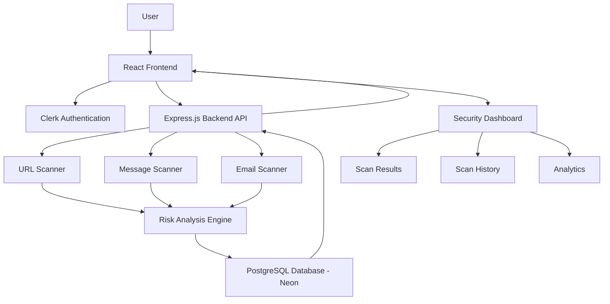
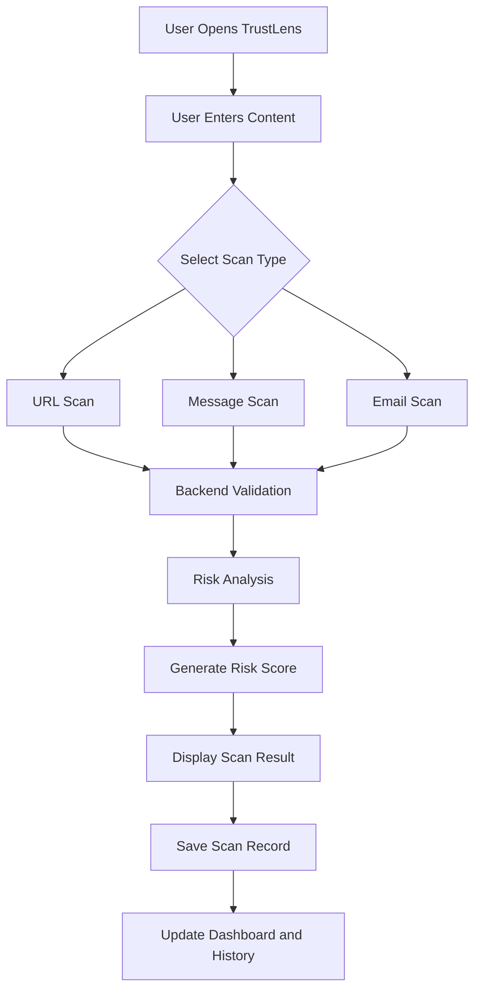

# 🛡️ TrustLens – A Digital Trust & Fraud Detection Platform

<p align="center">
  <b>Making Digital Communication Safer, One Scan at a Time.</b>
</p>

<p align="center">
  
  
  
  
  
</p>

## 🌐 Live Demo

**Live Application:** [Add your deployed application link here]

**GitHub Repository:** https://github.com/priyani44/TrustLens-

> Note: The application needs to be deployed before a public live demo link can be added.

---

## 📌 About The Project

TrustLens is an AI-powered digital trust and fraud detection platform designed to help users identify potentially fraudulent URLs, suspicious messages, and phishing emails.

With the increasing number of online scams, phishing attacks, fake websites, and fraudulent messages, it has become difficult for ordinary users to distinguish between legitimate and malicious digital content.

TrustLens aims to provide a centralized security dashboard where users can analyze suspicious digital content and understand its potential risk level before interacting with it.

The platform provides risk analysis, scan results, and scan history through an interactive dashboard.

## 🎯 Why We Built TrustLens

Digital fraud has become a major cybersecurity concern.

People regularly receive:
- Fake banking and payment links.
- Phishing emails pretending to be from trusted organizations.
- Fraudulent WhatsApp and SMS messages.
- Fake prize and lottery notifications.
- Suspicious login and account verification links.

Many users unknowingly interact with these links and messages, exposing their personal information and financial details.

**Our motivation was to build a platform that makes basic digital fraud detection accessible, understandable, and convenient for everyday users.**

TrustLens brings multiple scanning capabilities together in one platform instead of requiring users to rely on separate tools.

---

## ✨ Key Features

### 1. 🔗 URL Fraud Scanner
- Analyze website URLs for suspicious patterns.
- Identify potentially malicious URL structures.
- Detect IP-address-based URLs.
- Generate a risk assessment.
- Display scan results through the dashboard.

### 2. 💬 Message Fraud Scanner
- Analyze SMS messages.
- Check suspicious WhatsApp messages.
- Identify potentially fraudulent text and scam-related patterns.
- Display the scanning result and risk assessment.

### 3. 📧 Email Fraud Scanner
- Analyze email content for suspicious indicators.
- Identify potentially fraudulent messages.
- Highlight suspicious language and phishing-related patterns.
- Provide a risk assessment.

### 4. 📊 Security Dashboard
- Centralized security dashboard.
- Overview of scanning activity.
- Total scans, safe scans, and threat statistics.
- Recent security analysis.
- Quick access to different scanning options.

### 5. 📜 Scan History
- Store previous scan records.
- Retrieve historical scanning results.
- View previously analyzed content.
- Track risk levels and scan timestamps.

### 6. 🔐 User Authentication
- Secure user authentication using Clerk.
- Personalized dashboard experience.
- User profile management.

### 7. 📈 Risk Analysis
- Classify scanned content based on detected suspicious indicators.
- Display risk scores and risk categories.
- Help users understand potential digital threats.

---

## 🏗️ System Architecture

TrustLens follows a client-server architecture with a React-based frontend, an Express.js backend, and a PostgreSQL database hosted on Neon.

### High-Level Architecture



### Architecture Explanation

**1. Frontend Layer**

Built using React, TypeScript, and Tailwind CSS.

Responsibilities:
- User interface and dashboard.
- URL, message, and email input forms.
- Display scanning results.
- Fetch data from backend APIs.
- Display scan history and statistics.

**2. Authentication Layer**

Clerk handles user authentication and provides user account management.

**3. Backend Layer**

Built using Node.js, Express.js, and TypeScript.

Responsibilities:
- Handle incoming API requests.
- Validate user input.
- Process scanning requests.
- Perform suspicious-pattern analysis.
- Generate risk assessments.
- Communicate with the database.

**4. Database Layer**

Neon PostgreSQL stores scan records and historical analysis.

Responsibilities:
- Store scan details.
- Maintain scan history.
- Store risk scores and risk classifications.
- Retrieve previous scanning results.

---

## 🔄 How TrustLens Works

The following diagram illustrates the general scanning workflow.



### Scanning Process

1. The user logs into TrustLens.
2. The user selects the required scanning option.
3. The user enters a URL, message, or email content.
4. The frontend sends the request to the backend.
5. The backend validates and processes the input.
6. The risk analysis logic evaluates suspicious indicators.
7. A scanning result is generated.
8. The result is displayed on the dashboard.
9. Scan information is stored in PostgreSQL for historical tracking.

---

## 🛠️ Technology Stack

| Category | Technologies |
|---|---|
| Frontend | React.js, TypeScript |
| Styling | Tailwind CSS |
| Build Tool | Vite |
| Icons | Lucide React |
| Routing | React Router DOM |
| Backend | Node.js, Express.js |
| Backend Language | TypeScript |
| Database | Neon PostgreSQL |
| Database Library | node-postgres (pg) |
| Authentication | Clerk |
| API Communication | REST APIs |
| Development Environment | VS Code |
| Version Control | Git and GitHub |

---

## 📂 Project Structure

```text
TrustLens/
│
├── backend/
│   ├── src/
│   │   ├── controllers/
│   │   │   └── scanController.ts
│   │   │
│   │   ├── routes/
│   │   │   └── scanRoutes.ts
│   │   │
│   │   ├── db.ts
│   │   └── server.ts
│   │
│   ├── package.json
│   └── package-lock.json
│
├── frontend/
│   ├── src/
│   │   ├── pages/
│   │   │   └── Dashboard.tsx
│   │   │
│   │   ├── components/
│   │   ├── App.tsx
│   │   └── main.tsx
│   │
│   ├── public/
│   ├── package.json
│   └── vite.config.ts
│
├── .gitignore
├── package.json
├── package-lock.json
└── README.md
```

*Note: This is a simplified representation of the main project structure. Additional files and folders may exist.*

---

## 🚀 Getting Started

Follow these instructions to run TrustLens locally.

### Prerequisites

Make sure you have installed:

- Node.js
- npm
- Git
- A Neon PostgreSQL account
- A Clerk account

### 1. Clone the Repository

```bash
git clone https://github.com/priyani44/TrustLens-.git
```

### 2. Navigate to the Project

```bash
cd TrustLens-
```

### 3. Install Frontend Dependencies

```bash
cd frontend
npm install
```

### 4. Install Backend Dependencies

Open another terminal:

```bash
cd backend
npm install
```

### 5. Configure Environment Variables

Create a `.env` file inside the backend folder.

Add:

```env
DATABASE_URL=your_neon_database_connection_string
```

Create a `.env` file inside the frontend folder.

Add your Clerk publishable key:

```env
VITE_CLERK_PUBLISHABLE_KEY=your_clerk_publishable_key
```

Use your actual credentials locally. Never upload private keys or `.env` files to GitHub.

### 6. Run the Backend

From the backend directory:

```bash
npm run dev
```

Backend server:

```text
http://localhost:5000
```

### 7. Run the Frontend

From the frontend directory:

```bash
npm run dev
```

Frontend application:

```text
http://localhost:5173
```

Open the frontend URL in your browser to access TrustLens.

*The commands above assume the corresponding `dev` scripts are configured in the package.json files.*

---

## 🔌 Application Ports

| Component | Port | Local URL |
|---|---:|---|
| React Frontend | 5173 | http://localhost:5173 |
| Express Backend | 5000 | http://localhost:5000 |
| PostgreSQL | Cloud Hosted | Neon Database |

The frontend communicates with the backend through REST API endpoints.

---

## 🔗 API Overview

The backend exposes REST API endpoints for scanning and retrieving scan history.

| Method | Endpoint | Purpose |
|---|---|---|
| POST | `/api/scan/url` | Analyze a URL |
| GET | `/api/scan/history` | Retrieve scan history |
| POST | `/api/scan/...` | Message and email scanning routes |

The exact message and email endpoint paths depend on their implementation in the backend routes.

### Example URL Scan Request

```json
{
  "url": "https://example.com"
}
```

The backend validates the URL and returns a scanning response.

---

## 🌍 Where Can TrustLens Be Used?

TrustLens can be useful in several real-world scenarios:

**1. Individual Users**

People can check suspicious links and messages before interacting with them.

**2. Students and Educational Institutions**

Students can learn about phishing, digital fraud, and online safety.

**3. Small Businesses**

Businesses can use suspicious-content analysis as an additional precaution when handling unfamiliar links and messages.

**4. Digital Awareness Programs**

TrustLens can support cybersecurity awareness demonstrations and educational activities.

**5. General Cybersecurity Learning**

The platform can serve as a practical demonstration of web development, API integration, database management, and basic fraud detection techniques.

---

## 🔮 Future Enhancements

Potential improvements for future versions include:

- Machine learning-based phishing detection.
- Integration with threat intelligence APIs.
- Real-time URL reputation checking.
- Advanced email header analysis.
- Domain reputation and SSL certificate analysis.
- More detailed security reports.
- Improved risk scoring using multiple detection signals.
- Admin monitoring and reporting.
- Deployment with cloud hosting.
- Automated detection of newly emerging scam patterns.

---

## 🔒 Security Considerations

TrustLens is designed as a security-awareness and suspicious-content analysis tool.

A few important considerations:

- Never expose API keys or database credentials.
- Keep environment variables outside version control.
- Validate all incoming user input.
- Use HTTPS in production.
- Do not store unnecessary personal information.
- Treat scan results as indicators rather than definitive proof of fraud.

A URL or message marked safe should not automatically be considered completely trustworthy.

---

## 👩‍💻 Developer

**Developed by Priyani**

B.Tech Computer Science and Engineering

GitHub: [priyani44](https://github.com/priyani44)

Project: [TrustLens Repository](https://github.com/priyani44/TrustLens-)

---

## ⭐ Support

If you find this project interesting, consider giving the repository a star!

Your feedback and suggestions are welcome.

---

<p align="center">
  <b>TrustLens – Building a Safer Digital World.</b>
</p>
